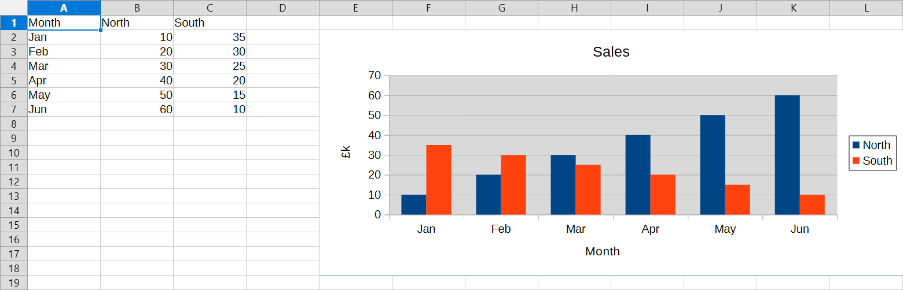
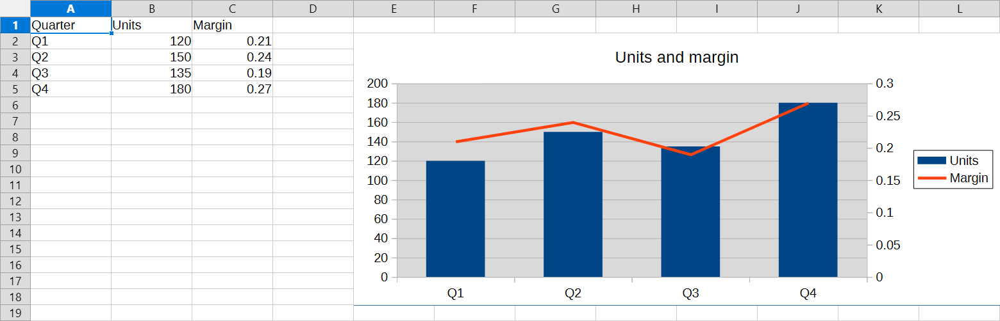

```@meta
CurrentModule = OpenDocumentSpreadsheets.Charts
```

# Creating charts

## A first chart

[`addChart`](@ref) makes a chart over a range of cells, and [`addSeries`](@ref) adds its series:

```julia
using OpenDocumentSpreadsheets
using OpenDocumentSpreadsheets.Charts

xf = newods("Data")
ws = xf["Data"]
ws["A1"] = "Month"; ws["B1"] = "North"; ws["C1"] = "South"
for (i, m) in enumerate(["Jan", "Feb", "Mar", "Apr", "May", "Jun"])
    ws[i+1, 1] = m; ws[i+1, 2] = 10i; ws[i+1, 3] = 40 - 5i
end

c = addChart(ws, :column; anchor = "E2:L18", title = "Sales", xtitle = "Month", ytitle = "£k")
addSeries(c, "B2:B7"; categories = "A2:A7", name_ref = "B1")
addSeries(c, "C2:C7"; categories = "A2:A7", name_ref = "C1")
writeods("sales.ods", xf)
```

<!-- shot: chart_first cells=12x19 -->


The frame sits in the anchor's first cell and resizes with its cells up to the last. A series takes
its values, and optionally its categories and its name, as references: `"B2:B7"` on the chart's
sheet, or `"Data.B2:B7"` on another.

## The kinds

| Kind | |
|---|---|
| `:column`, `:stackedColumn`, `:percentStackedColumn` | vertical bars |
| `:bar`, `:stackedBar`, `:percentStackedBar` | horizontal bars |
| `:line`, `:lineMarkers`, `:stackedLine`, `:percentStackedLine`, `:stackedLineMarkers`, `:percentStackedLineMarkers` | lines, with or without symbols |
| `:area`, `:stackedArea`, `:percentStackedArea` | areas |
| `:pie`, `:doughnut`, `:pieOfPie`, `:barOfPie` | pies |
| `:scatter`, `:bubble` | XY charts |
| `:radar`, `:filledRadar` | LibreOffice's net charts |
| `:combo` | columns and lines |
| `:stock`, `:stockOHLC`, `:stockVolume`, `:stockVolumeOHLC` | LibreOffice's stock charts |

```julia
xf = newods("Kinds")
k = xf["Kinds"]
k["A1:C1"] = ["x" "a" "b"]
for i in 1:6
    k[i+1, 1] = i; k[i+1, 2] = i^2 / 4 + 2; k[i+1, 3] = 8 - i
end
for (n, (kind, anchor)) in enumerate([(:column, "E1:J14"), (:stackedBar, "K1:P14"), (:lineMarkers, "Q1:V14"),
                                      (:pie, "E16:J29"), (:scatter, "K16:P29"), (:area, "Q16:V29")])
    ch = addChart(k, kind; anchor, title = string(kind))
    if kind === :scatter
        addSeries(ch, "B2:B7"; categories = "A2:A7", name_ref = "B1")
        addSeries(ch, "C2:C7"; categories = "A2:A7", name_ref = "C1")
    elseif kind === :pie
        addSeries(ch, "B2:B7"; categories = "A2:A7", name_ref = "B1")
    else
        addSeries(ch, "B2:B7"; categories = "A2:A7", name_ref = "B1")
        addSeries(ch, "C2:C7"; categories = "A2:A7", name_ref = "C1")
    end
end
```

<!-- shot: chart_kinds cells=22x30 zoom=60 -->


## Combo charts

[`makeCombo`](@ref) makes a column or line chart of two or more series LibreOffice's column and line
chart: its last series becomes a line on a secondary y axis, the others columns.

```julia
xf = newods("Units")
u = xf["Units"]
u["A1:C1"] = ["Quarter" "Units" "Margin"]
u["A2:C5"] = ["Q1" 120 0.21; "Q2" 150 0.24; "Q3" 135 0.19; "Q4" 180 0.27]
c = addChart(u, :column; anchor = "E2:L18", title = "Units and margin")
addSeries(c, "B2:B5"; categories = "A2:A5", name_ref = "B1")
addSeries(c, "C2:C5"; categories = "A2:A5", name_ref = "C1")
makeCombo(c)
```

<!-- shot: chart_combo cells=12x19 -->


## LibreOffice's options

`addChart` takes LibreOffice's chart options too:
- `subtitle`;
- `threeD` and `deep`, for a 3-D chart;
- `dataTable`, a table of the data under the plot;
- `interpolation`: smooth, B-spline and stepped lines;
- `emptyCells` (leave a gap, plot zero, or join over) and `includeHidden`;
- `sortByX`, for an XY chart;
- `startAngle`, for a pie;
- `data` and `seriesIn`, as LibreOffice's chart wizard: the series of a whole range at once.

```julia
c = addChart(ws, :line; anchor = "E20:L36", data = "A1:C7", seriesIn = :columns,
             interpolation = :stepStart, subtitle = "Stepped lines")
```

LibreOffice's model shows in a few rules:
- A chart's categories are its x axis's: every series of a non-XY chart shares them.
- Smoothing is the chart's: all its lines or none.
- Titles are text.

[`deleteChart`](@ref) removes a chart and its frame.

## Not available

LibreOffice can't store these, so asking for one is an error that says why: titles that follow a
cell, and categories of a series' own.
