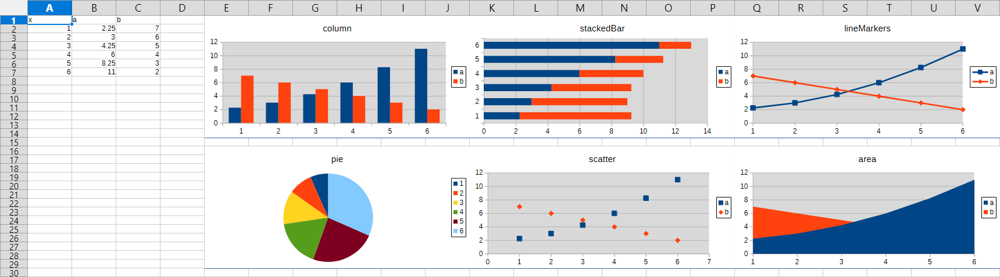

```@meta
CurrentModule = OpenDocumentSpreadsheets.Charts
```

# Creating charts

## A first chart

[`addChart`](@ref) makes a chart over a range of cells, and [`addSeries`](@ref) adds its series:

```julia
using OpenDocumentSpreadsheets
using OpenDocumentSpreadsheets.Charts

xf = newods("Data")
sh = xf["Data"]
sh["A1"] = "Month"; sh["B1"] = "North"; sh["C1"] = "South"
for (i, m) in enumerate(["Jan", "Feb", "Mar", "Apr", "May", "Jun"])
    sh[i+1, 1] = m; sh[i+1, 2] = 10i; sh[i+1, 3] = 40 - 5i
end

c = addChart(sh, :column; anchor = "E2:L18", title = "Sales", xtitle = "Month", ytitle = "£k")
addSeries(c, "B2:B7"; categories = "A2:A7", name_ref = "B1")
addSeries(c, "C2:C7"; categories = "A2:A7", name_ref = "C1")
writeods("sales.ods", xf)
```

<!-- shot: chart_first cells=12x19 -->


The frame sits in the anchor's first cell and resizes with its cells up to the last. A series takes
its values, and optionally its categories and its name, as references: `"B2:B7"` on the chart's
sheet, or `"Data.B2:B7"` on another.

## The kinds

| Kind | |
|---|---|
| `:column`, `:stackedColumn`, `:percentStackedColumn` | vertical bars |
| `:bar`, `:stackedBar`, `:percentStackedBar` | horizontal bars |
| `:line`, `:lineMarkers`, `:stackedLine`, `:percentStackedLine`, `:stackedLineMarkers`, `:percentStackedLineMarkers` | lines, with or without symbols |
| `:area`, `:stackedArea`, `:percentStackedArea` | areas |
| `:pie`, `:doughnut`, `:pieOfPie`, `:barOfPie` | pies |
| `:scatter`, `:bubble` | XY charts |
| `:radar`, `:filledRadar` | LibreOffice's net charts |
| `:combo` | columns and lines |
| `:stock`, `:stockOHLC`, `:stockVolume`, `:stockVolumeOHLC` | LibreOffice's stock charts |
| `:histogram` | a histogram (see [below](#Histograms)) |

```julia
xf = newods("Kinds")
kinds = xf["Kinds"]
kinds["A1:C1"] = ["x" "a" "b"]
for i in 1:6
    kinds[i+1, 1] = i; kinds[i+1, 2] = i^2 / 4 + 2; kinds[i+1, 3] = 8 - i
end
for (n, (kind, anchor)) in enumerate([(:column, "E1:J14"), (:stackedBar, "K1:P14"), (:lineMarkers, "Q1:V14"),
                                      (:pie, "E16:J29"), (:scatter, "K16:P29"), (:area, "Q16:V29")])
    ch = addChart(kinds, kind; anchor, title = string(kind))
    if kind === :scatter
        addSeries(ch, "B2:B7"; categories = "A2:A7", name_ref = "B1")
        addSeries(ch, "C2:C7"; categories = "A2:A7", name_ref = "C1")
    elseif kind === :pie
        addSeries(ch, "B2:B7"; categories = "A2:A7", name_ref = "B1")
    else
        addSeries(ch, "B2:B7"; categories = "A2:A7", name_ref = "B1")
        addSeries(ch, "C2:C7"; categories = "A2:A7", name_ref = "C1")
    end
end
```

<!-- shot: chart_kinds cells=22x30 zoom=60 -->


## Combo charts

[`makeCombo`](@ref) makes a column or line chart of two or more series LibreOffice's column and line
chart: its last series becomes a line on a secondary y axis, the others columns.

```julia
xf = newods("Units")
units = xf["Units"]
units["A1:C1"] = ["Quarter" "Units" "Margin"]
units["A2:C5"] = ["Q1" 120 0.21; "Q2" 150 0.24; "Q3" 135 0.19; "Q4" 180 0.27]
c = addChart(units, :column; anchor = "E2:L18", title = "Units and margin")
addSeries(c, "B2:B5"; categories = "A2:A5", name_ref = "B1")
addSeries(c, "C2:C5"; categories = "A2:A5", name_ref = "C1")
makeCombo(c)
```

<!-- shot: chart_combo cells=12x19 -->


## Histograms

A histogram counts the values of one series that fall in each bin, as the Histogram Chart type of
LibreOffice's Insert ▸ Chart does:

```julia
xf = newods("Heights")
heights = xf["Heights"]
heights["A1"] = "Height (cm)"
for i in 1:200
    heights[i+1, 1] = round(170 + 9 * sin(i) * cos(i / 7) + 4 * sin(i / 3); digits = 1)
end
h = addChart(heights, :histogram; anchor = "C2:J18")
addSeries(h, "A2:A201"; name_ref = "A1")
setSeriesBinning(h, 1; binCount = 8)
```

<!-- shot: histogram cells=11x19 -->


Bins are set by their width (`binSize`) or count (`binCount`). LibreOffice draws the bins stored with
the chart, but labels the bars with the ranges of its own automatic bins.

In the file a histogram is an ordinary chart. Here its handle is a [`ChartEx`](@ref): the chart getters
read it as any other chart (its title, legend, series and data), and its bins have functions of their
own (`setSeriesBinning`, `getSeriesBinning`). The formatting setters take other charts only. A
histogram takes the titles (`title`, `subtitle`, `xtitle`, `ytitle`) and one series, with no
categories.

## Chart sheets

A chart sheet is a sheet that holds only a chart, anchored to the page. Give `addChart` the file and
a `sheetname`, rather than a sheet and an anchor:

```julia
c = addChart(xf, :column; sheetname = "Chart", title = "Heights")
addSeries(c, "Heights.A2:A21"; name_ref = "Heights.A1")
```

It is an ordinary sheet in the file, so its references name their sheet: `"Heights.A2:A21"`.
`addChart(xf, :histogram; sheetname)` makes a histogram on a sheet of its own.

## LibreOffice's options

`addChart` takes LibreOffice's chart options too:
- `subtitle`;
- `threeD` and `deep`, for a 3-D chart;
- `dataTable`, a table of the data under the plot;
- `interpolation`: smooth, B-spline and stepped lines;
- `emptyCells` (leave a gap, plot zero, or join over) and `includeHidden`;
- `sortByX`, for an XY chart;
- `startAngle`, for a pie;
- `data` and `seriesIn`, as LibreOffice's chart wizard: the series of a whole range at once.

```julia
c = addChart(sh, :line; anchor = "E20:L36", data = "A1:C7", seriesIn = :columns,
             interpolation = :stepStart, subtitle = "Stepped lines")
```

LibreOffice's model shows in a few rules:
- A chart's categories are its x axis's: every series of a non-XY chart shares them.
- Smoothing is the chart's: all its lines or none.
- Titles are text.

[`deleteChart`](@ref) removes a chart and its frame.

## Not available

LibreOffice can't store these, so asking for one is an error that says why: titles that follow a
cell, and categories of a series' own.

LibreOffice has no waterfall, funnel, treemap, sunburst, Pareto or box and whisker charts, so there
are no such kinds.
