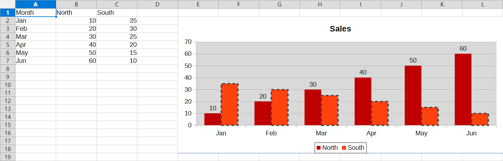
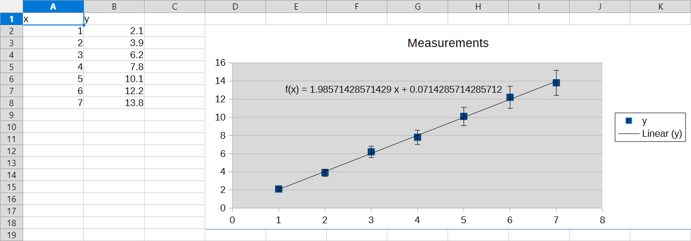

```@meta
CurrentModule = OpenDocumentSpreadsheets.Charts
```

# Formatting charts

The setters change what LibreOffice's chart edit mode changes: a series' fill and line, the legend,
the axes, titles and labels. They work on the charts made here and on a file's own.

```julia
using OpenDocumentSpreadsheets
using OpenDocumentSpreadsheets.Charts

xf = newods("Data")
ws = xf["Data"]
ws["A1"] = "Month"; ws["B1"] = "North"; ws["C1"] = "South"
for (i, m) in enumerate(["Jan", "Feb", "Mar", "Apr", "May", "Jun"])
    ws[i+1, 1] = m; ws[i+1, 2] = 10i; ws[i+1, 3] = 40 - 5i
end
c = addChart(ws, :column; anchor = "E2:L18", title = "Sales")
addSeries(c, "B2:B7"; categories = "A2:A7", name_ref = "B1")
addSeries(c, "C2:C7"; categories = "A2:A7", name_ref = "C1")

setSeriesFill(c, 1, "C00000")
setSeriesLine(c, 2; color = "404040", width = 2, dash = :sysDash)
setLegendPos(c, :b)
setAxisMin(c, :y, 0); setAxisMax(c, :y, 70); setAxisMajorUnit(c, :y, 10)
setChartTitleTextProp(c, :bold, true)
setLabelFlag(c, 1, :value, true)
```

<!-- shot: chart_format cells=12x19 -->


## Trendlines and error bars

LibreOffice's Insert ▸ Trend Line and Insert ▸ Y Error Bars:

```julia
xf = newods("Trend")
t = xf["Trend"]
t["A1:B1"] = ["x" "y"]
for (i, y) in enumerate([2.1, 3.9, 6.2, 7.8, 10.1, 12.2, 13.8])
    t[i+1, 1] = i; t[i+1, 2] = y
end
c = addChart(t, :scatter; anchor = "D2:K18", title = "Measurements")
addSeries(c, "B2:B8"; categories = "A2:A8", name_ref = "B1")
addTrendline(c, 1, :linear; displayEquation = true)
setErrorBars(c, 1; type = :percent, value = 10)
```

<!-- shot: chart_trend cells=11x19 -->


## LibreOffice's model

Some setters follow LibreOffice's model of a chart:
- **Theme colours** (`:accent1`, `SchemeColor`) are resolved against the document's theme, with
  their tints and shades applied. LibreOffice keeps colours in a chart, not links to the theme.
- **Line, XY and radar series** have one colour, their line's and their symbols'.
- **Legend corners** (`:tr`, `:tl`, `:bl`, `:br`) are custom positions.
- **A minor unit** must divide the major one, since LibreOffice stores the number of minor steps.

Other options include gradients and hatches for fills, explosion of pie slices
([`setSeriesExplosion`](@ref)), and how axis labels are arranged
([`setAxisLabelArrangement`](@ref)).

LibreOffice can't store titles that follow a cell, compound lines, line joins, marker borders,
bubble-size labels, or text caps, kerning and outlines: asking for them is an error.

The [Charts: every function](../api-charts-all.md) page lists every setter.
