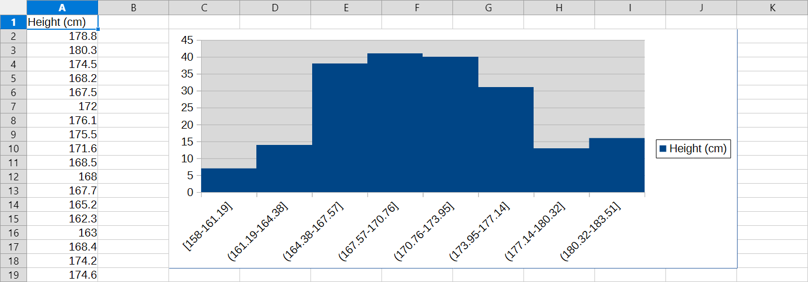

```@meta
CurrentModule = OpenDocumentSpreadsheets.Charts
```

# Histograms and chart sheets

## Histograms

[`addChartEx`](@ref) makes LibreOffice's histogram, which counts the values that fall in each bin:

```julia
using OpenDocumentSpreadsheets
using OpenDocumentSpreadsheets.Charts

xf = newods("Heights")
sh = xf["Heights"]
sh["A1"] = "Height (cm)"
for i in 1:200
    sh[i+1, 1] = round(170 + 9 * sin(i) * cos(i / 7) + 4 * sin(i / 3); digits = 1)
end
h = addChartEx(sh, :histogram, "A2:A201"; anchor = "C2:J18", name_ref = "A1")
setSeriesBinning(h, 1; binCount = 8)
```

<!-- shot: histogram cells=11x19 -->


Bins are set by their width (`binSize`) or count (`binCount`). LibreOffice draws the bins stored with
the chart, but labels the bars with the ranges of its own automatic bins.

## Chart sheets

A chart sheet is a sheet that holds only a chart, anchored to the page:

```julia
c = addChart(xf, :column; sheetname = "Chart", title = "Heights")
addSeries(c, "Heights.A2:A21"; name_ref = "Heights.A1")
```

It is an ordinary sheet in the file, so its references name their sheet: `"Heights.A2:A21"`.
`addChartEx(xf, …; sheetname)` makes a histogram on a sheet of its own.

## Not available

LibreOffice has no waterfall, funnel, treemap, sunburst, Pareto or box and whisker charts, so
asking `addChartEx` for one is an error that says why.
