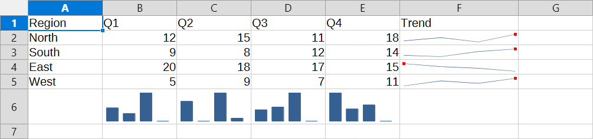

```@meta
CurrentModule = OpenDocumentSpreadsheets
```

# Sparklines

A sparkline is a small chart inside a cell, as LibreOffice's Insert ▸ Sparkline makes. The functions
are in the main module:

```julia
using OpenDocumentSpreadsheets

xf = newods("Trends")
sh = xf["Trends"]
sh["A1:F1"] = ["Region" "Q1" "Q2" "Q3" "Q4" "Trend"]
sh["A2:E5"] = ["North" 12 15 11 18; "South" 9 8 12 14; "East" 20 18 17 15; "West" 5 9 7 11]
addSparklines(sh, "F2:F5", "B2:E5"; high = true, highColor = "red")   # one per row
addSparklines(sh, "B6:E6", "B2:E5"; type = :column)                   # one per column
setColumnWidth(sh, "F"; width = 16)
setRowHeight(sh, 6; height = 30)
getSparklines(sh)
```

```@raw html
<!-- shot: sparklines cells=7x7 -->
```


```julia
deleteSparklines(sh, "F3")
```

The types are `:line`, `:column` and `:winloss` (LibreOffice's stacked type). Sparklines made
together are a group, which shares its options: markers for the high, low, first, last and negative
points and their colours, the line weight, the axis, and the scale (`min`, `max`).

A sparkline goes with its cell through inserts and deletes, and its data moves as a chart's does.

## Not available

LibreOffice keeps no date axis for sparklines, so `dateRange` is an error that says why.
