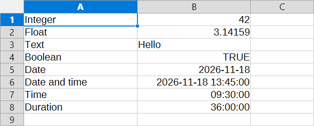
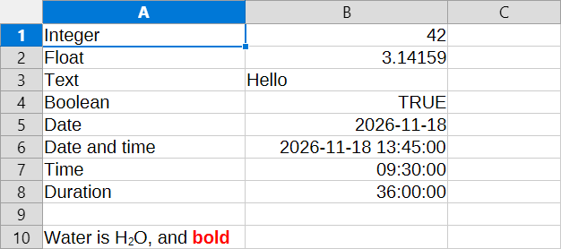

```@meta
CurrentModule = OpenDocumentSpreadsheets
```

# Values and types

An OpenDocument cell stores its value with a type. OpenDocumentSpreadsheets reads it as follows:

| Cell | Julia value |
|---|---|
| number, percentage, currency | `Int64` if the value is whole and its number format shows no decimals, else `Float64` |
| date | `Date`, or `DateTime` if it has a time or its format shows one |
| time (a duration) | `Dates.Time` from 0 to under 24 hours; otherwise a `Dates.CompoundPeriod` such as `1 day, 12 hours` |
| boolean | `Bool` |
| text | `String` (several paragraphs are joined with `"\n"`) |
| empty, empty text, error | `missing` |

Percentages are read as their value (50% reads as `0.5`). The currency of a currency cell is in its
[`Cell`](@ref) (`getcell(sheet, "B2").currency`).

## Writing values

Writing takes numbers, strings, `Bool`, `Date`, `DateTime`, `Time`, periods (durations), and
`missing` or `nothing` (an empty cell). Whole numbers keep their type (`7` reads back as `7`, `7.0`
as `7.0`), and floats are written exactly.

```julia
using Dates

xf = newods("Types")
types = xf["Types"]
types["A1:A8"] = ["Integer", "Float", "Text", "Boolean", "Date", "Date and time", "Time", "Duration"]
types["B1"] = 42
types["B2"] = 3.14159
types["B3"] = "Hello"
types["B4"] = true
types["B5"] = Date(2026, 11, 18)
types["B6"] = DateTime(2026, 11, 18, 13, 45)
types["B7"] = Time(9, 30)
types["B8"] = Hour(36)
setColumnWidth(types, "A:B"; width = 18)
```

```@raw html
<!-- shot: values_types cells=3x9 -->
```


Dates, times and booleans need a number format, or LibreOffice treats them as plain numbers the next
time it saves. OpenDocumentSpreadsheets gives them ISO formats (`2026-11-18`, `2026-11-18 13:45:00`,
`[HH]:MM:SS`, `TRUE`). A cell whose existing format fits the new value keeps it.

## Errors

A formula whose result is an error reads as `missing`. [`iserror`](@ref) and [`geterror`](@ref) tell
the two apart, with the text LibreOffice shows. A formula written by OpenDocumentSpreadsheets has no
result until LibreOffice calculates it, so take a file LibreOffice has saved, whose sheet `sh` has
`=1/0` in C2:

```julia
iserror(sh, "C2")      # true
geterror(sh, "C2")     # "#DIV/0!", or a code such as "Err:502"
```

## Cells

[`getcell`](@ref) gives the whole cell: its value type, value, formula, style name, currency, error
text and merge spans. It is public but not exported, so import it by name:

```julia
using OpenDocumentSpreadsheets: getcell

c = getcell(types, "B2")   # 3.14159, on the Types sheet above
c.datatype     # :float, :percentage, :currency, :date, :time, :boolean, :string, :error, :empty
c.value
c.style        # the name of its cell style
```

Where a sheet holds nothing, `getcell` returns an [`EmptyCell`](@ref).

## Rich text

A text cell can hold runs of differently formatted text, as LibreOffice makes when part of a cell's
text is selected and formatted:

```julia
using OpenDocumentSpreadsheets: getRichTextString

rt = RichTextString(RichTextRun("Water is H"), RichTextRun("2", [:vertAlign => "subscript"]),
                    RichTextRun("O, and "), RichTextRun("bold", [:bold => true, :color => "red"]))
types["A10"] = rt
getRichTextString(types, "A10") == rt        # true
types["A10"]                                 # "Water is H2O, and bold", its text
```

```@raw html
<!-- shot: values_richtext cells=3x10 -->
```


A run's attributes are `:bold`, `:italic`, `:under`, `:strike`, `:vertAlign` (`"superscript"` or
`"subscript"`), `:color`, `:size` and `:name`. A run takes the attributes it doesn't set from the
cell, and a line break starts a new paragraph.

Rich text in a single format is saved as ordinary text, its format becoming the cell's font,
except for a superscript or subscript, which a cell's font can't hold. `getRichTextString` reads
rich text made in LibreOffice too, and gives `nothing` for a cell with no formatted runs. Writing a new
value to the cell drops its runs, as LibreOffice does.
