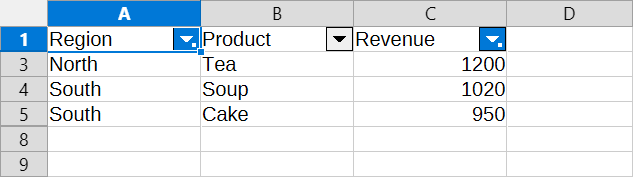

```@meta
CurrentModule = OpenDocumentSpreadsheets
```

# AutoFilter and sorting

A sheet's AutoFilter is LibreOffice's Data ▸ AutoFilter: filter buttons on a range's header row.
[`setAutoFilter`](@ref) can also filter and sort the range, so the file opens filtered and sorted:

```julia
using OpenDocumentSpreadsheets
using OpenDocumentSpreadsheets: getAutoFilter

xf = newods("Sales")
sh = xf["Sales"]
sh["A1:C1"] = ["Region" "Product" "Revenue"]
rows = [("North", "Tea", 1200), ("South", "Cake", 950), ("East", "Tea", 1430),
        ("West", "Soup", 610), ("North", "Cake", 880), ("South", "Soup", 1020)]
for (i, r) in enumerate(rows)
    sh[i+1, 1] = r[1]; sh[i+1, 2] = r[2]; sh[i+1, 3] = r[3]
end
setColumnWidth(sh, "A:C"; width = 12)

setAutoFilter(sh, "A1:C7"; filters = ["Region" => ["North", "South"], "Revenue" => (">" => 900)],
              sort = "Revenue" => :descending)
getAutoFilter(sh)           # CellRange("A1:C7")
```

```@raw html
<!-- shot: autofilter cells=4x8 -->
```


```julia
setAutoFilter(sh, :; sort = ["Region", "Revenue" => :descending], naturalSort = true)
removeAutoFilter(sh)        # shows every row again
```

## Filtering

Rows that don't match are hidden, as LibreOffice's Data ▸ More Filters ▸ Refresh Range hides them:
- Text that LibreOffice reads as a number (`"10"`, `"2026-11-23"`) is compared with numbers by value.
- List items are compared as text, so a date matches only at midnight.
- A top or bottom ranking (`(:top, 10)`) counts every cell that isn't empty. Text and errors rank
  above the largest numbers, where they take up places but aren't shown: `(:top, 2)` over `x`, 5
  and 9 shows only the 9.
- `caseSensitive` and `noDuplicates` are LibreOffice's *Case sensitive* and *No duplications*
  options, and a regular expression (`r"^a.*"`) can be a criterion.

## Sorting

Rows are put in LibreOffice's order: numbers (and `FALSE`, `TRUE`), then text in LibreOffice's
alphabetical order, then errors, with empty cells last.
- Each row's cells move with their formats, validity rules, notes, links and pictures, and a hidden
  row stays hidden as it moves.
- A formula moves as if copied (`=B5*2` moved to row 2 becomes `=B2*2`), and is saved without a
  result: LibreOffice calculates it when it opens the file.
- Row heights, and formulas elsewhere that refer to the sorted cells, stay as they are.
- The options are `caseSensitive`, `naturalSort` (`"a2"` before `"a10"`) and
  `includeFormats=false`, which moves the values but leaves the formats.
- A sort of merged cells (unless `includeFormats=false`) or of array formulas is an error.

## Not available

LibreOffice can't store these filters, so asking for one is an error that says why: above or below
average, and dates relative to today (`:today`, `:Q1`, …).
