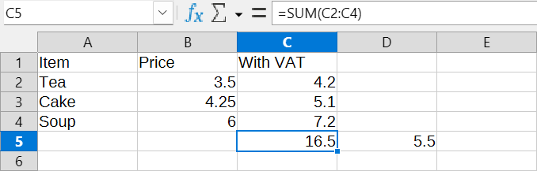

```@meta
CurrentModule = OpenDocumentSpreadsheets
```

# Formulas

OpenDocumentSpreadsheets reads and writes formulas in the notation LibreOffice shows in its formula
bar: `=SUM(A1:B2,1)`, `=AVERAGE(A1:A10,'Other sheet'.B2)`. In the file, OpenDocument stores them in
OpenFormula syntax (`of:=SUM([.A1:.B2];1)`), which `raw = true` reads and writes.

```julia
using OpenDocumentSpreadsheets
using OpenDocumentSpreadsheets: getFormula

xf = newods("Prices")
sh = xf["Prices"]
sh["A1:C1"] = ["Item" "Price" "With VAT"]
sh["A2:B4"] = ["Tea" 3.5; "Cake" 4.25; "Soup" 6]
for r in 2:4
    setFormula(sh, "C$r"; val = "=B$r*1.2")
end
setFormula(sh, "C5"; val = "=SUM(C2:C4)")
setFormula(sh, "D5"; val = "of:=[.C5]/3", raw = true)

getFormula(sh, "C5")                # "=SUM(C2:C4)"
getFormula(sh, "C5"; raw = true)    # "of:=SUM([.C2:.C4])"
```

<!-- shot: formulas cells=5x6 cursor=C5 bar -->


## The notation

- English function names, with `,` between arguments.
- In inline arrays, `,` between columns and `;` between rows (`{1,2;3,4}`).
- References name their sheet with `.` (`Sheet2.A1`), as in LibreOffice.
- Functions that LibreOffice stores under another name are translated with LibreOffice's table of names:
  `IFS` is stored as `COM.MICROSOFT.IFS`, `CEILING.XCL` as `COM.MICROSOFT.CEILING`, and so on.

`getFormula` and the getters on other pages are public but not exported: import them by name, as
above, or write `OpenDocumentSpreadsheets.getFormula`.

## Results

OpenDocumentSpreadsheets doesn't calculate formulas. A formula written here has no result until the
file is opened in LibreOffice (or another spreadsheet program), which calculates it. A formula read
from a file gives the result LibreOffice last saved with it.
