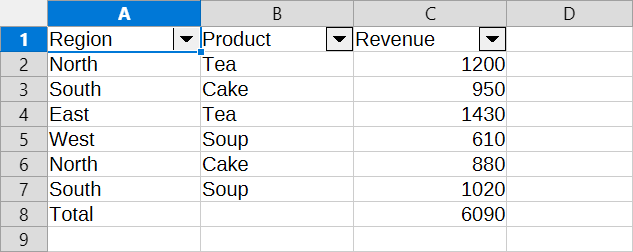

```@meta
CurrentModule = OpenDocumentSpreadsheets
```

# Database ranges

A database range is LibreOffice's named block of rows under a header row (Data ▸ Define Range), with
filter buttons on its header. The functions for database ranges call one a *table*: [`addtable!`](@ref),
[`table`](@ref), [`settotals!`](@ref) and the type [`Table`](@ref).

This is a narrower sense than [`readtable`](@ref)'s, which reads any block of rows under a header
row, whether it is a database range or not (see the [Tutorial](../tutorial/tutorial.md#Reading-a-table)).
Given `table_name`, `readtable` reads a database range by its name instead.

Adding or changing a database range needs a file open for writing (`mode="rw"`, or made by
[`newods`](@ref)); [`table`](@ref) and the readers also work on files opened for reading.

```julia
using OpenDocumentSpreadsheets

xf = newods("Sales")
s = xf["Sales"]
s["A1:C1"] = ["Region" "Product" "Revenue"]
rows = [("North", "Tea", 1200), ("South", "Cake", 950), ("East", "Tea", 1430),
        ("West", "Soup", 610), ("North", "Cake", 880), ("South", "Soup", 1020)]
for (i, r) in enumerate(rows)
    s[i+1, 1] = r[1]; s[i+1, 2] = r[2]; s[i+1, 3] = r[3]
end
setColumnWidth(s, "A:C"; width = 12)

t = addtable!(s, "A1:C7"; name = "Sales")
settotals!(t, "Region" => "Total", "Revenue" => :sum)     # a totals row under the range
writeods("sales.ods", xf)
```

<!-- shot: tables cells=4x9 -->


## Working with a range

```julia
appendtable!(t, (Region = ["East"], Product = ["Cake"], Revenue = [700]))   # rows added inside it
gettablerange(t, "Revenue")                     # the column's data cells
OpenDocumentSpreadsheets.table(xf, "Sales")     # the range, by name
writeods("sales.ods", xf; overwrite = true)

readtable("sales.ods", "Sales"; table_name = "Sales")         # read it by name
people = (Name = ["Ann", "Bob"], Team = ["North", "South"])     # or a DataFrame
writetable("people.ods", people; sheetname = "People", as_table = true, table_name = "People",
           overwrite = true)
deletetable!(t)
```

## LibreOffice's database ranges

- A range's name is formed as a named range's is, but is apart from them.
- Ranges may overlap, and a range may be its header row alone.
- A totals row's settings are read from its cells' formulas, which are written as LibreOffice
  writes them (`SUBTOTAL(109,$Sales.$C$2:$C$7)`).

## Not available

LibreOffice has no styles for database ranges: format their cells instead. `style` (and
`writetable`'s `table_style`) is accepted only as `nothing` or `"None"`; any other style is an error.
