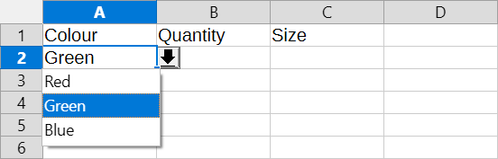

```@meta
CurrentModule = OpenDocumentSpreadsheets
```

# Validity

LibreOffice's Data ▸ Validity limits what a cell accepts: a list of values (shown as a drop-down), a
whole number or decimal within limits, a date, a time, a text length, or a formula. A file must be
open for writing; [`getDataValidation`](@ref OpenDocumentSpreadsheets.getDataValidation) also works
on files opened for reading.

```julia
using OpenDocumentSpreadsheets
using OpenDocumentSpreadsheets: getDataValidation

xf = newods("Orders")
o = xf["Orders"]
o["A1:C1"] = ["Colour" "Quantity" "Size"]
lists = addsheet!(xf, "Lists")
lists["A1:A3"] = ["Small"; "Medium"; "Large";;]

addDataValidation(o, "A2:A20"; type = :list, values = ["Red", "Green", "Blue"])
addDataValidation(o, "B2:B20"; type = :whole, operator = :between, formula1 = 1, formula2 = 10,
                  error = "A whole number from 1 to 10", errorStyle = :stop)
addDataValidation(o, "C2:C20"; type = :list, formula1 = "Lists.\$A\$1:\$A\$3", sortEntries = true)
o["A2"] = "Green"
getDataValidation(o, "B5")
```

LibreOffice shows a list rule's values as a drop-down on the cell:

<!-- shot: validity cells=4x6 cursor=A2 dropdown -->


A cell has one rule: a new rule replaces the rule of the cells it covers, and
[`deleteDataValidation`](@ref) removes one:

```julia
deleteDataValidation(o, "C2:C20")
```

## The Validity dialog and the keywords

Each setting of LibreOffice's Data ▸ Validity dialog is a keyword of
[`addDataValidation`](@ref OpenDocumentSpreadsheets.addDataValidation):

| Validity dialog | Keyword |
|---|---|
| *Criteria* ▸ *Allow*: All values, Integer, Decimal, Date, Time, Text length, Custom | `type = :any`, `:whole`, `:decimal`, `:date`, `:time`, `:textLength`, `:custom` |
| *Allow*: List, with its entries | `type = :list`, `values = ["Red", "Green"]` |
| *Allow*: Cell range | `type = :list`, `formula1 = "Lists.$A$1:$A$3"` |
| *Data*: equal, less than, greater than, less than or equal, greater than or equal to, not equal | `operator = :equal`, `:lessThan`, `:greaterThan`, `:lessThanOrEqual`, `:greaterThanOrEqual`, `:notEqual` |
| *Data*: valid range, invalid range | `operator = :between` (the default), `:notBetween` |
| *Minimum* (or the one value), *Maximum* | `formula1`, `formula2` |
| Custom's formula | `formula1 = "=ISNUMBER(B2)"` |
| *Allow empty cells* | `allowBlank` (`true` by default) |
| *Show selection list* (a list) | `dropdown` |
| *Sort entries ascending* (a list) | `sortEntries` |
| *Case sensitive* | `caseSensitive` |
| *Input Help*: *Show input help when cell is selected*, *Title*, *Input help* | `showInputMessage`, `promptTitle`, `prompt` |
| *Error Alert*: *Handle invalid values*, *Action*, *Title*, *Error message* | `showErrorMessage`, `errorStyle = :stop`, `:warning` or `:information`, `errorTitle`, `error` |

`formula1` and `formula2` take numbers, dates and times as they are, or a reference or formula in
the notation LibreOffice's formula bar shows.
