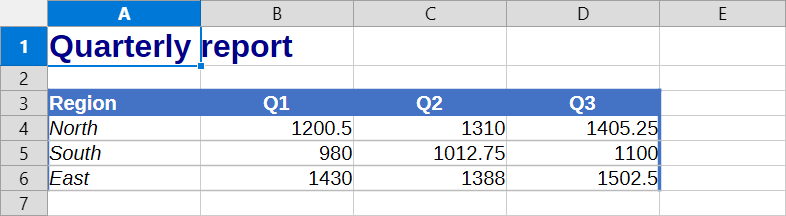
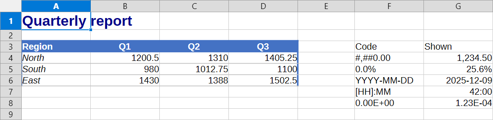
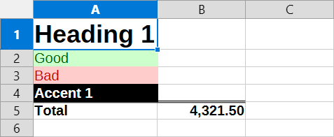

```@meta
CurrentModule = OpenDocumentSpreadsheets
```

# Cell formats

These functions set what LibreOffice's Format ▸ Cells dialog sets: [`setFont`](@ref),
[`setFill`](@ref), [`setBorder`](@ref), [`setAlignment`](@ref) and [`setFormat`](@ref), with their
getters and their `setUniform*` variants. A file must be open for writing (`mode="rw"`, or made by
[`newods`](@ref)); the getters also work on files opened for reading.

They take a cell (`"B2"`), a range (`"B2:D4"`), whole columns (`"A:C"`) or rows (`"3:5"`), a list of
ranges (`"A1:B2,D4"`), a named range, or rows and columns as integers, ranges, vectors or `:`. On a
file, the reference names its sheet: `setFont(xf, "Sheet1.A1"; bold = true)`.

## Fonts, fills, borders and alignment

```julia
using OpenDocumentSpreadsheets

xf = newods("Report")
s = xf["Report"]
s["A1"] = "Quarterly report"
s["A3:D3"] = ["Region" "Q1" "Q2" "Q3"]
s["A4:D6"] = ["North" 1200.5 1310 1405.25; "South" 980 1012.75 1100; "East" 1430 1388 1502.5]
setColumnWidth(s, "A:D"; width = 12)

setFont(s, "A1"; bold = true, size = 16, color = "darkblue")
setFont(s, "A3:D3"; bold = true, color = "white")
setFill(s, "A3:D3"; pattern = "solid", fgColor = "4472C4")
setBorder(s, "A3:D6"; outside = ["style" => "medium", "color" => "4472C4"])
setBorder(s, "A4:D6"; bottom = ["style" => "thin", "color" => "BBBBBB"])
setAlignment(s, "B3:D3"; horizontal = "center")
setFont(s, "A4:A6"; italic = true)
```

<!-- shot: cellformat_basic cells=5x7 -->


Setters return the name of the cell style they made, for a single cell. Getters report what the
cell's style resolves to:

```julia
using OpenDocumentSpreadsheets: getFont, getFill

getFont(s, "A1")          # its font: name, size, bold, colour, ...
getFill(s, "B3")          # its fill
```

Every setter works on empty cells, as in LibreOffice, and whole columns and rows are formatted to
the end of the sheet. `setUniformFont`, `setUniformFill`, `setUniformBorder` and the others give a
range one style, and [`setOutsideBorder`](@ref) draws a frame round it.

## Number formats

[`setFormat`](@ref) takes a format code, as typed in Format ▸ Cells ▸ Numbers ▸ Format code, or one
of the named formats. [`getText`](@ref OpenDocumentSpreadsheets.getText) shows a value as LibreOffice
shows it:

```julia
s["F3:F8"] = ["Code"; "#,##0.00"; "0.0%"; "YYYY-MM-DD"; "[HH]:MM"; "0.00E+00";;]
s["G3"] = "Shown"
for (r, v) in zip(4:8, [1234.5, 0.256, 46000, 1.75, 0.000123])
    s[r, 7] = v
    setFormat(s, "G$r"; format = s[r, 6])
end
setColumnWidth(s, "F:G"; width = 12)

OpenDocumentSpreadsheets.getText(s, "G4")      # "1,234.50"
```

<!-- shot: cellformat_numbers cells=7x9 -->


Number formats are stored as OpenDocument data styles, in the form LibreOffice writes for the same
code. A value is shown as LibreOffice shows it: General shows up to 15 significant digits, for
example.

## Named cell styles

The Styles deck (F11) lists a file's cell styles: "Default", "Heading 1", "Good", and styles of your
own.
- [`setCellStyle`](@ref) applies a style.
- [`addCellStyle!`](@ref) defines one, from the same keywords the setters take.
- [`getCellStyle`](@ref OpenDocumentSpreadsheets.getCellStyle) gives a cell's style.

```julia
xf = newods("Styles")
st = xf["Styles"]
st["A1"] = "Heading 1"; st["A2"] = "Good"; st["A3"] = "Bad"; st["A4"] = "Accent 1"
st["A5"] = "Total"; st["B5"] = 4321.5
for r in 1:4
    setCellStyle(st, "A$r", st[r, 1])        # LibreOffice's built-in styles
end
addCellStyle!(xf, "Total"; parent = "Default",
              font = (bold = true,), border = (top = ["style" => "double"],), format = "#,##0.00")
setCellStyle(st, "A5:B5", "Total")
setColumnWidth(st, "A"; width = 14)
OpenDocumentSpreadsheets.getCellStyle(st, "A1")   # "Heading 1"
```

<!-- shot: cellformat_styles cells=3x6 -->


- **Direct formatting stays on top**, as in LibreOffice. Applying a style removes the cell's own
  settings only for what the style sets (its font size, say). The rest stays, including the number
  format unless the style has one.
- **LibreOffice's built-in styles** are added, in LibreOffice's own definitions, to a file that lacks
  them: Heading, Heading 1, Heading 2, Text, Note, Footnote, Hyperlink, Status, Good, Neutral, Bad,
  Warning, Error, Accent, Accent 1 to 3, and Result.
- **Names** are the ones LibreOffice shows. In the file, a name such as "My Style" is stored as
  `My_20_Style`; either form is accepted.

## What a cell style can't hold

- Superscript and subscript apply to text, not cells: use [rich text](../concepts/values.md#Rich-text).
- Pattern fills are blended into one colour, as LibreOffice shows them.
