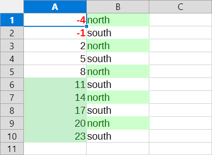
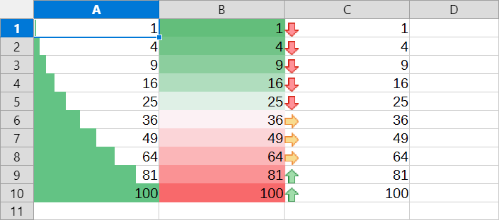

```@meta
CurrentModule = OpenDocumentSpreadsheets
```

# Conditional formats

[`setConditionalFormat`](@ref) makes the rules of LibreOffice's Format ▸ Conditional menu: conditions
that apply a cell style when they hold, and data bars, colour scales and icon sets.

## Conditions

```julia
using OpenDocumentSpreadsheets

xf = newods("Sales")
s = xf["Sales"]
for i in 1:10
    s[i, 1] = i * 3 - 7
    s[i, 2] = isodd(i) ? "north" : "south"
end
setConditionalFormat(s, "A1:A10", :cellIs; operator = "greaterThan", value = "10",
                     dxStyle = "greenfilltext")
setConditionalFormat(s, "A1:A10", :cellIs; operator = "lessThan", value = "0",
                     font = ["color" => "red", "bold" => "true"])
setConditionalFormat(s, "B1:B10", :containsText; value = "north", style = "Good")
```

<!-- shot: condfmt_conditions cells=3x11 -->


The conditions are:
- comparisons (`:cellIs`), top and bottom ranks (`:top10`), above and below average;
- text that contains, doesn't contain, begins or ends with a value;
- date periods (today, last week, this month, this year, …);
- blanks, errors, unique and duplicate values;
- formulas (`:expression`).

A condition's format is a cell style:
- `style` applies a style you already have, or one of LibreOffice's built-in styles
  (`style = "Good"`).
- `dxStyle` (a preset such as `"redfilltext"`) or a custom `font`, `fill`, `border` or `format` makes
  a style of the rule's own, `ConditionalStyle_1`, `ConditionalStyle_2` and so on, which the Styles
  deck lists.

Conditions set on the same range become one conditional format, in the order they were set, and
LibreOffice applies the first that holds. Cells keep their own styles underneath.

### The dialog and the keywords

Each entry of LibreOffice's Format ▸ Conditional ▸ Condition dialog is a type, with its own keywords:

| Conditional Formatting dialog | `setConditionalFormat` |
|---|---|
| *Cell value* is equal to, less than, greater than, less than or equal to, greater than or equal to, not equal to | `:cellIs`, `operator = "equal"`, `"lessThan"`, `"greaterThan"`, `"lessEqual"`, `"greaterEqual"`, `"notEqual"`, and `value` |
| *Cell value* is between, is not between | `:cellIs`, `operator = "between"`, `"notBetween"`, `value` and `value2` |
| *Cell value* is duplicate, is not duplicate | `:duplicateValues`, `:uniqueValues` |
| *Cell value* is in top N elements, bottom N elements, top N percent, bottom N percent | `:top10`, `operator = "topN"`, `"bottomN"`, `"topN%"`, `"bottomN%"`, and `value` (N) |
| *Cell value* is above average, below average, above or equal average, below or equal average | `:aboveAverage`, `operator = "aboveAverage"`, `"belowAverage"`, `"aboveEqAverage"`, `"belowEqAverage"` |
| *Cell value* is error, is not error | `:containsErrors`, `:notContainsErrors` |
| *Cell value* begins with, ends with, contains, does not contain | `:beginsWith`, `:endsWith`, `:containsText`, `:notContainsText`, and `value` |
| *Formula is* | `:expression`, `formula = "B2>$D$1"` (relative to the range's top-left cell) |
| *Date is* Today, Yesterday, …, Next year | `:timePeriod`, `operator = "today"`, `"yesterday"`, `"tomorrow"`, `"last7Days"`, `"thisWeek"`, `"lastWeek"`, `"nextWeek"`, `"thisMonth"`, `"lastMonth"`, `"nextMonth"`, `"thisYear"`, `"lastYear"`, `"nextYear"` |
| *Apply Style* | `style = "Good"` (an existing style), or `dxStyle`, `font`, `fill`, `border`, `format` (a new one) |
| *All Cells* ▸ Color Scale (2 Entries), (3 Entries) | `:colorScale` |
| *All Cells* ▸ Data Bar | `:dataBar` |
| *All Cells* ▸ Icon Set | `:iconSet`, `iconset = "3Arrows"` and the others |

`:containsBlanks` and `:notContainsBlanks` have no entry of their own: they are written as a
*Formula is* condition, `LEN(TRIM(A1))=0` or `>0`, which LibreOffice shows as such.

## Data bars, colour scales and icon sets

```julia
xf = newods("Scales")
c = xf["Scales"]
for i in 1:10
    c[i, 1] = i^2; c[i, 2] = i^2; c[i, 3] = i^2
end
setConditionalFormat(c, "A1:A10", :dataBar; databar = "green")
setConditionalFormat(c, "B1:B10", :colorScale; colorscale = "redwhitegreen")
setConditionalFormat(c, "C1:C10", :iconSet; iconset = "3Arrows")
setColumnWidth(c, "A:C"; width = 14)
```

<!-- shot: condfmt_scales cells=4x11 -->


Each comes with presets: the data bar colours, two- and three-colour scales, and LibreOffice's icon
sets, including its `3Smilies` and `3ColorSmilies`. [`setColoredDataBars`](@ref
OpenDocumentSpreadsheets.setColoredDataBars) sets a data bar's colours for positive and negative
values, and `minLength` and `maxLength` its shortest and longest bar.

## Reading and clearing

```julia
OpenDocumentSpreadsheets.getConditionalFormats(s)            # range => (type = "cellIs", priority = 1), …
OpenDocumentSpreadsheets.clearConditionalFormats(s, "B:B")   # 1 rule removed
```

## LibreOffice's rules

- Whole columns and rows keep their full extent, and empty cells can have rules.
- Rules move with their cells: inserted and deleted rows and columns, sheet copies and renames rewrite
  them as LibreOffice does. A sort moves none.

## Not available

LibreOffice can't store these, so asking for one is an error that says why: "stop if true",
standard-deviation forms of above average (use an `:expression`), data bar borders, right-to-left
data bars, and custom or reversed icon sets.
