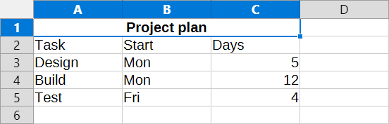

```@meta
CurrentModule = OpenDocumentSpreadsheets
```

# Merged cells

```julia
using OpenDocumentSpreadsheets

xf = newods("Plan")
s = xf["Plan"]
s["A1"] = "Project plan"
s["A2:C2"] = ["Task" "Start" "Days"]
s["A3:C5"] = ["Design" "Mon" 5; "Build" "Mon" 12; "Test" "Fri" 4]
mergeCells(s, "A1:C1")                 # A1 keeps its value; B1 and C1 are covered
setAlignment(s, "A1"; horizontal = "center")
setFont(s, "A1"; bold = true)
```

<!-- shot: merged cells=4x6 cursor=A1 -->


```julia
getMergedCells(s)                      # [A1:C1], or nothing
isMergedCell(s, "B1")                  # true
getMergedBaseCell(s, "B1")             # (baseCell = A1, baseValue = "Project plan")
removeMergedCells(s, "A1:C1")          # or removeMergedCells(s) for every merge
```

A merge is an anchor cell and the cells it covers, as LibreOffice writes it (Format ▸ Merge and
Unmerge Cells). Covered cells keep their formatting, and their values are emptied, as when LibreOffice
merges cells without moving their contents. A merge may reach past the used area.
