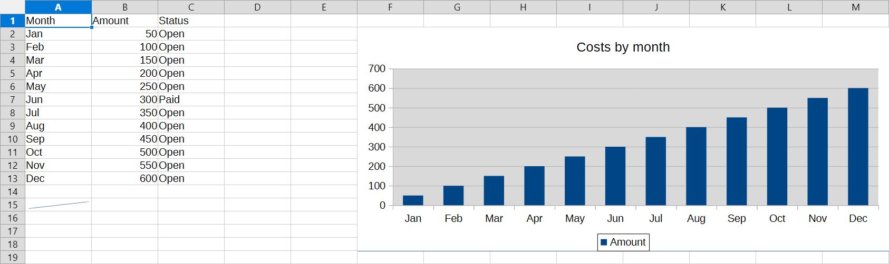

```@meta
CurrentModule = OpenDocumentSpreadsheets
```

# OpenDocumentSpreadsheets.jl

Read and write OpenDocument spreadsheets (`.ods`, `.fods`, `.ots`) in pure Julia.

OpenDocument (ISO/IEC 26300) is the spreadsheet format of LibreOffice and of the public bodies that
standardise on open formats. OpenDocumentSpreadsheets reads and writes it directly: no Python, no
LibreOffice and no other program is needed. What it writes is what LibreOffice writes, so a file
made here opens in LibreOffice Calc looking as it would had you made it there.



If you know [XLSX.jl](https://github.com/JuliaData/XLSX.jl), its functions are here with the same
names and arguments: [Coming from XLSX.jl](@ref) lists the few differences.

## Installation

```julia
using Pkg
Pkg.add(url = "https://github.com/TimG1964/OpenDocumentSpreadsheets.jl")
```

OpenDocumentSpreadsheets supports Julia 1.10 and later.

## A first look

The [Tutorial](tutorial/tutorial.md) makes this `budget.ods` in its first step.

```julia
using OpenDocumentSpreadsheets

xf = readods("budget.ods")        # open a file
sheetnames(xf)                    # ["Income", "Costs"]
sh = xf["Costs"]
sh["B3"]                          # one value
sh["A1:C10"]                      # a matrix of values

dt = readtable("budget.ods", "Costs")   # a table, for DataFrames or any Tables.jl sink

writetable("costs.ods", dt; sheetname = "Costs", overwrite = true)   # write it to a new file
```

## Where to go next

- [Getting started](tutorial/tutorial.md) walks through reading, writing and editing a file.
- [Supported features](features.md) lists what the package does.
- The guide's sections cover data, formatting, layout, sheets, pictures and notes, and charts, each
  with pictures of the result in LibreOffice.
- The [API reference](api.md) documents every function.
