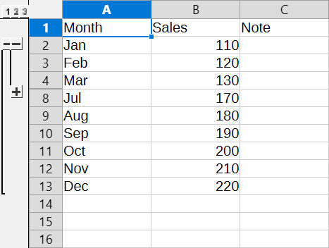

```@meta
CurrentModule = OpenDocumentSpreadsheets
```

# Hiding and grouping rows and columns

## Hiding

```julia
using OpenDocumentSpreadsheets

xf = newods("Year")
sh = xf["Year"]
months = ["Jan", "Feb", "Mar", "Apr", "May", "Jun", "Jul", "Aug", "Sep", "Oct", "Nov", "Dec"]
sh["A1:B1"] = ["Month" "Sales"]
for (i, m) in enumerate(months)
    sh[i+1, 1] = m; sh[i+1, 2] = 100 + 10i
end
sh["C1"] = "Note"

setRowHidden(sh, 3:4)                    # hidden = true by default
setColumnHidden(sh, "C")
setColumnHidden(sh, "C"; hidden = false)  # shown again
OpenDocumentSpreadsheets.isRowHidden(sh, 3)  # true
setRowHidden(sh, 3:4; hidden = false)
```

## Grouping

LibreOffice's Data ▸ Group and Outline puts outline buttons beside grouped rows and columns, which
collapse and expand them:

```julia
groupRows(sh, 2:13)                      # the year
groupRows(sh, 2:4)                       # the first quarter, inside it
groupRows(sh, 5:7; collapsed = true)     # the second, its rows hidden
OpenDocumentSpreadsheets.getRowOutlineLevel(sh, 3)  # 2
```

<!-- shot: groups cells=3x14 -->


```julia
groupColumns(sh, "B:C")
ungroupRows(sh, 5:7)
```

Groups are LibreOffice's nested groups: two groups side by side stay two groups, a group may not
cross another, and there are at most seven levels. Ungrouping removes a whole group, and lifts the
groups inside it.
