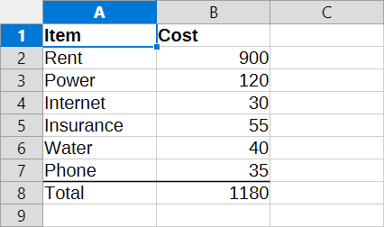

```@meta
CurrentModule = OpenDocumentSpreadsheets
```

# Inserting and deleting rows and columns

```julia
using OpenDocumentSpreadsheets
using OpenDocumentSpreadsheets: getFormula

xf = newods("Costs")
s = xf["Costs"]
s["A1:B1"] = ["Item" "Cost"]
s["A2:B5"] = ["Rent" 900; "Power" 120; "Water" 40; "Phone" 35]
s["A6"] = "Total"
setFormula(s, "B6"; val = "=SUM(B2:B5)")
setFont(s, "A1:B1"; bold = true)
setBorder(s, "A6:B6"; top = ["style" => "thin"])

insertRows(s, 4; count = 2)      # two empty rows before row 4
s["A4:B5"] = ["Internet" 30; "Insurance" 55]
getFormula(s, "B8")              # "=SUM(B2:B7)"
```

<!-- shot: insert_rows cells=3x9 -->


```julia
deleteRows(s, 3)                 # Power
insertColumns(s, "B")            # or a number: insertColumns(s, 2)
deleteColumns(s, "B")
insertRows(xf, "Costs.2")        # on the file, with the sheet named
```

References follow the lines they point to, as they do in LibreOffice:
- formulas on every sheet, named ranges, validity rules, conditional formats, database ranges, print
  ranges and chart series;
- a range grows when lines are inserted inside it, and shrinks when some of its lines are deleted;
- a reference whose cells are all deleted becomes `#REF!`.

Merged cells, formats, hidden lines, groups, notes, pictures and charts move with their cells. An
inserted row takes the cell formats of the row above, and an inserted column those of the column to
its left, with the width of the column it pushes right.
