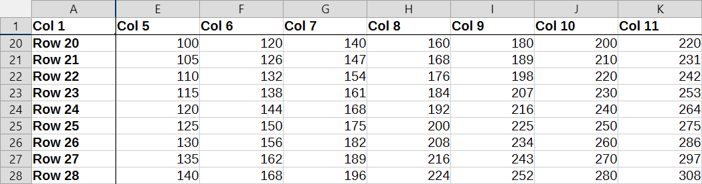
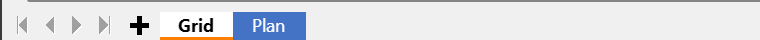

```@meta
CurrentModule = OpenDocumentSpreadsheets
```

# Panes, the view and tab colours

## Freezing and splitting

LibreOffice's View ▸ Freeze Cells keeps rows and columns in place while the rest scrolls:

```julia
using OpenDocumentSpreadsheets

xf = newods("Grid")
s = xf["Grid"]
for r in 1:40, c in 1:12
    s[r, c] = r == 1 ? "Col $c" : c == 1 ? "Row $r" : r * c
end
setFont(s, 1, :; bold = true)
setFont(s, :, 1; bold = true)

freezePanes(s; nrows = 1, ncols = 1)       # or freezePanes(s, "B2")
setSheetView(s; topLeftCell = "E20")       # scrolled down and right
```

<!-- shot: frozen cells=8x10 top=keep cursor=keep -->


```julia
splitPanes(s; nrows = 10)                  # a split that doesn't freeze
removePanes(s)
```

## The view

[`setSheetView`](@ref) sets how a sheet looks when LibreOffice opens it: its zoom, gridlines, cursor
and the cell at its top left.

```julia
setSheetView(s; zoom = 125, showGridLines = false, activeCell = "C3", topLeftCell = "A1")
OpenDocumentSpreadsheets.getSheetView(s)
```

The view is kept in LibreOffice's view settings. Some of them are the whole file's, as in
LibreOffice: row and column headers, zero values and the page-break preview.

## Tab colours and hidden sheets

```julia
addsheet!(xf, "Plan"); addsheet!(xf, "Notes")
setTabColor(s, "FF8000")                   # or a colour name: "orange"
setTabColor(xf["Plan"], "4472C4")
setSheetVisibility(xf["Notes"], :hidden)
```

<!-- shot: tabs tabs -->


```julia
removeTabColor(s)
setSheetVisibility(xf["Notes"], :visible)
```

The last visible sheet can't be hidden.
