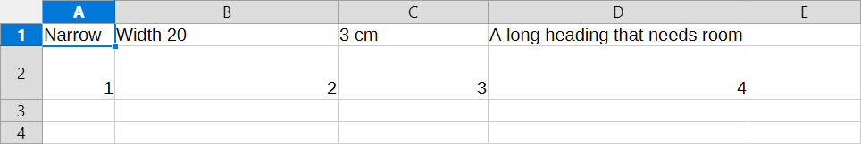

```@meta
CurrentModule = OpenDocumentSpreadsheets
```

# Column width and row height

```julia
using OpenDocumentSpreadsheets

xf = newods("Sizes")
s = xf["Sizes"]
s["A1:D1"] = ["Narrow" "Width 20" "3 cm" "A long heading that needs room"]
s["A2:D2"] = [1 2 3 4]

setColumnWidth(s, "A"; width = 6)              # in characters
setColumnWidth(s, "B"; width = 20)
setColumnWidth(s, "C"; width = 3, unit = :cm)  # or :mm, :in, :pt
setRowHeight(s, 2; height = 30)                # in points
autofitColumns(s, "D")                         # LibreOffice's optimal width

OpenDocumentSpreadsheets.getColumnWidth(s, "B1")   # 20.7109375
OpenDocumentSpreadsheets.getRowHeight(s, "A2")     # 30.2109375, the height plus padding
```

<!-- shot: widths cells=5x4 -->


OpenDocument stores widths as lengths. A width in characters is about that many digits of the default
font, with a little padding.
[`autofitColumns`](@ref) does what LibreOffice's Format ▸ Columns ▸ Optimal Width does: it measures
each cell's text as LibreOffice shows it, in the cell's font. With no columns given it fits them all.

[`writetable`](@ref) takes widths and number formats for its columns, also when streaming:

```julia
writetable("out.ods", df; column_widths = [12, 30], column_formats = Dict("price" => "#,##0.00"))
```
