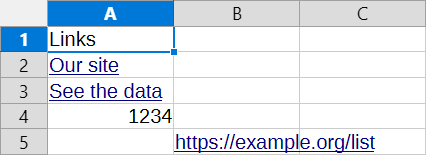

```@meta
CurrentModule = OpenDocumentSpreadsheets
```

# Hyperlinks

```julia
using OpenDocumentSpreadsheets
using OpenDocumentSpreadsheets: getHyperlink, getHyperlinks

xf = newods("Links")
sh = xf["Links"]
addsheet!(xf, "Data")["B10"] = 42
sh["A1"] = "Links"
addHyperlink(sh, "A2"; url = "https://example.org/", display = "Our site")
addHyperlink(sh, "A3"; location = "Data.B10", display = "See the data")
sh["A4"] = 1234
addHyperlink(sh, "A4"; url = "https://example.org/figures")     # a link of the cell itself
addHyperlink(sh, "B5:B7"; url = "https://example.org/list")      # one link per cell
getHyperlink(sh, "A2")      # (sheet, ref, url, location, display, tooltip)
getHyperlinks(sh)           # every link on the sheet
```

```@raw html
<!-- shot: hyperlinks cells=3x5 -->
```


```julia
deleteHyperlink(sh, "A3")
```

- **Text cells** get a link round their text, as LibreOffice's Insert ▸ Hyperlink makes. `display`
  sets the text.
- **Numbers and formulas** get a link of the cell itself, since their shown text isn't the cell's.
- **Places in the file** are given with `location`, a cell or range on a sheet.

A link stays with its cell through edits, inserts, deletes, sorts and sheet copies.

## Not available

LibreOffice has no tooltips for links, so `tooltip` is an error that says why.
