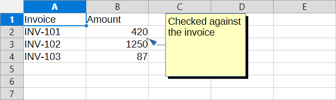

```@meta
CurrentModule = OpenDocumentSpreadsheets
```

# Notes and comments

A note is LibreOffice's Insert ▸ Comment: a box of text attached to a cell, marked by a small square
in the cell's corner.

```julia
using OpenDocumentSpreadsheets
using OpenDocumentSpreadsheets: getComment, getThreadedComment

xf = newods("Invoices")
s = xf["Invoices"]
s["A1:B1"] = ["Invoice" "Amount"]
s["A2:B4"] = ["INV-101" 420; "INV-102" 1250; "INV-103" 87]
addComment(s, "B3", "Checked against the invoice"; author = "Ann", visible = true)
getComment(s, "B3").text            # "Checked against the invoice"
```

<!-- shot: notes cells=5x7 -->


```julia
deleteComment(s, "B3")
```

`visible = true` shows a note always, as View ▸ Comments or Show Comment does, rather than only
when the mouse is over its cell. `date` sets the date LibreOffice shows on the note.

## Threaded comments

A threaded comment is a conversation on a cell: a comment and its replies, each with an author, that
can be marked resolved.

```julia
addThreadedComment(s, "B4", "Is this final?"; author = "Ann")
addThreadedReply(s, "B4", "Yes."; author = "Bob")
setThreadedCommentResolved(s, "B4")
getThreadedComment(s, "B4")
```

LibreOffice keeps a thread inside a note, which shows the thread's text in versions of LibreOffice
without threads.

All of these stay with their cells: a cell whose value changes keeps its note, and inserting or
deleting rows and columns, sorting and copying sheets move notes with their cells.
