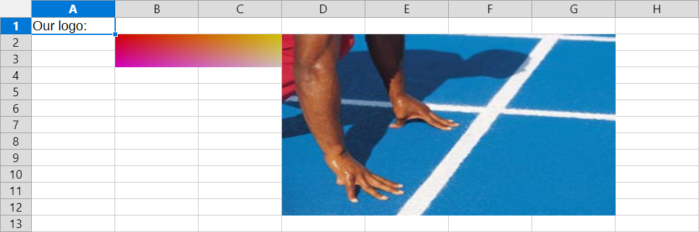

```@meta
CurrentModule = OpenDocumentSpreadsheets
```

# Pictures

```julia
using OpenDocumentSpreadsheets
using OpenDocumentSpreadsheets: getImages

xf = newods("Report")
s = xf["Report"]
s["A1"] = "Our logo:"
addImage(s, "B2", "logo.png")                               # one cell per 64 × 20 pixels
addImage(s, "D2:G12", "chart.jpg"; alt = "Sales by month")  # stretched to fill D2:G12
getImages(s)              # (sheet, media_name, from, to, alt, description) for each
```

<!-- shot: pictures cells=8x13 -->


```julia
deleteImage(s, "B2")
```

A picture (PNG, JPEG or GIF) is anchored to its first cell and resizes with its cells, as
LibreOffice's Anchor ▸ To Cell (resize with cell) does. It moves with its cell through inserts,
deletes, sorts and sheet copies. LibreOffice's own `alt` and `description` are its Name and
Description in Format ▸ Name and Description.

LibreOffice has no pictures inside cells, so `inCell=true` is an error.
