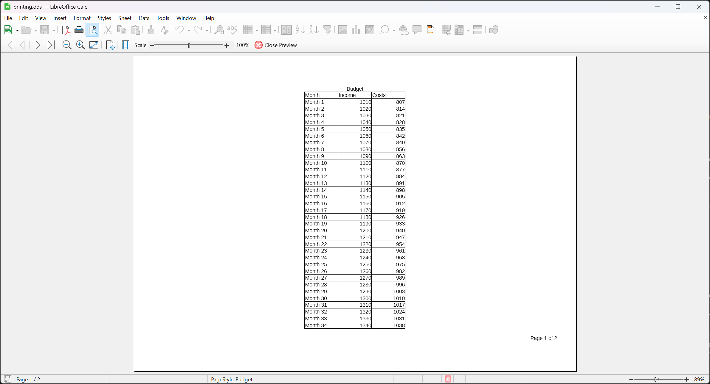

```@meta
CurrentModule = OpenDocumentSpreadsheets
```

# Page setup and printing

These set what LibreOffice's Format ▸ Page Style and Format ▸ Print Ranges set.

```julia
using OpenDocumentSpreadsheets

xf = newods("Budget")
sh = xf["Budget"]
sh["A1:C1"] = ["Month" "Income" "Costs"]
for i in 1:60
    sh[i+1, 1] = "Month $i"; sh[i+1, 2] = 1000 + 10i; sh[i+1, 3] = 800 + 7i
end

setPageSetup(sh; orientation = :landscape, paperSize = :A4, fitToWidth = 1, fitToHeight = 0)
setPageMargins(sh; left = 0.5, right = 0.5, top = 0.75, bottom = 0.75)  # in inches
setPrintOptions(sh; gridLines = true, horizontalCentered = true)
setPrintArea(sh, "A1:C61")
setPrintTitles(sh; rows = 1)                     # repeated on every page
setHeaderFooter(sh; header = (center = "&A",), footer = (right = "Page &P of &N",))
```

<!-- shot: printing preview -->


## Headers and footers

Header and footer text takes codes for fields and fonts, stored as LibreOffice's fields and text
styles:

| Code | |
|---|---|
| `&P`, `&N` | the page number, the number of pages |
| `&D`, `&T` | the date, the time |
| `&A`, `&F` | the sheet's name, the file's name |
| `&B`, `&I`, `&U`, `&"Font,Bold"`, `&12` | bold, italic, underline, a font, a size |

[`headerFooterFont`](@ref) and [`headerFooterField`](@ref) build them:

```julia
setHeaderFooter(sh; header = headerFooterFont(bold = true) * "Budget " * headerFooterField(:date))
```

## Page styles

Each sheet's settings go into a page style of its own (`PageStyle_<sheet>`), which Format ▸ Page Style
edits, so changing one sheet leaves the others alone. A sheet without one prints LibreOffice's
default header and footer, and [`getHeaderFooter`](@ref) says so.

- **Paper:** `paperSize` takes the common sizes (`:A4`, `:letter`, …), and `paperWidth` and
  `paperHeight` any other, in cm unless `unit` says otherwise.
- **Units:** margins are in inches, paper sizes in cm; [Units](../layout/widthAndHeight.md#Units)
  lists them all.
- **Scaling:** `fitToWidth` and `fitToHeight` fit the print to pages across and down, and
  `scaleToPages` fits it to a number of pages in all.
- **Print titles** must lie inside a group or apart from it.
