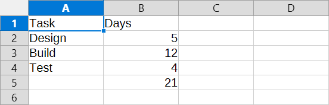

```@meta
CurrentModule = OpenDocumentSpreadsheets
```

# Creating and editing files

## Opening a file

| | |
|---|---|
| `readods(path)`, `openods(path)` | read only |
| `openods(path; mode="rw")` | read and edit; save with [`saveods`](@ref) or [`writeods`](@ref) |
| `openods(path; mode="w")`, [`newods`](@ref) | a new, empty file |

With the do-block form of [`openods`](@ref), a file opened for writing is saved when the block ends
(but not if the block throws):

```julia
openods("budget.ods"; mode = "rw") do xf
    xf["Costs"]["B7"] = 1250.0
end
```

Without it, save explicitly:

```julia
xf = openods("budget.ods"; mode = "rw")
xf["Costs"]["B8"] = 980.0
saveods(xf)                                   # back to budget.ods
writeods("budget-copy.ods", xf)               # or to another file
```

## A new file

[`newods`](@ref) makes a file with one sheet, named as you choose. [`addsheet!`](@ref) adds more:

```julia
xf = newods("Plan")
plan = xf["Plan"]
plan["A1"] = "Task"; plan["B1"] = "Days"
plan["A2:B4"] = ["Design" 5; "Build" 12; "Test" 4]
setFormula(plan, "B5"; val = "=SUM(B2:B4)")

memo = addsheet!(xf, "Notes")
memo["A1"] = "Estimates agreed on 18 November."
writeods("plan.ods", xf)
```

<!-- shot: creating_new cells=4x6 -->


A sheet is addressed by name or by position (`xf["Plan"]`, `xf[1]`), and [`sheetnames`](@ref)
lists them in order.

## Writing a table

[`writetable`](@ref) writes any Tables.jl source (a DataFrame, a named tuple of vectors, …) with its
column names as a header row. [`writetable!`](@ref) writes one into a sheet of an open file:

```julia
writetable("people.ods", df; sheetname = "People")
writetable("all.ods", "People" => df, "Notes" => notes)    # several sheets

xf = openods("plan.ods"; mode = "rw")
writetable!(addsheet!(xf, "People"), df; anchor_cell = "B2")
saveods(xf)
```

## Editing keeps the rest of the file

OpenDocumentSpreadsheets doesn't rebuild a file it edits. It copies the original and rewrites only the
rows that hold edited or formatted cells, and the columns whose formats changed:
- untouched sheets, settings, pictures, charts and the other parts stay byte for byte;
- styles are only added: new automatic styles go into the sheet's content and named styles into the
  file's styles, and styles it made that no cell uses any more aren't written;
- in an edited row, the cells you didn't change keep their formatting, notes and links.

A file saved without edits is identical to the original. So a file made in LibreOffice, with
features this package doesn't know about, can be edited safely.
