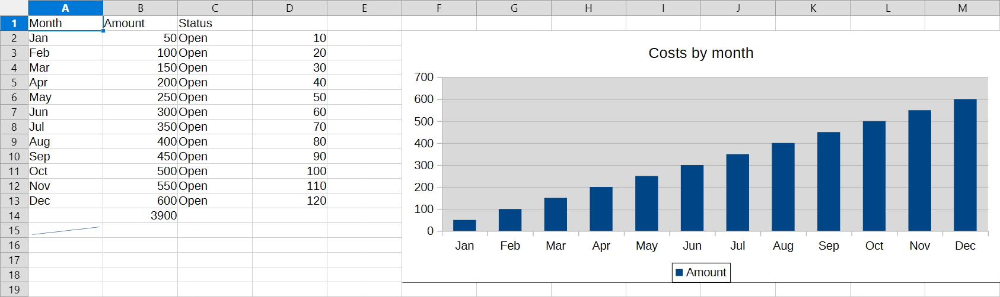

```@meta
CurrentModule = OpenDocumentSpreadsheets
```

# Tutorial

This tutorial reads a file, writes a new one, formats it, and edits a file in place. Each step
links to the page that covers it in full.

## Reading a file

[`readods`](@ref) opens a file and returns an [`ODSFile`](@ref). A sheet is read the first time it
is used.

```julia
using OpenDocumentSpreadsheets

xf = readods("data.ods")
sheetnames(xf)            # the sheets, in order
sh = xf["Sheet1"]         # or xf[1]

sh["A1"]                  # a value: a number, string, Date, ..., or missing
sh["A1:C3"]               # a Matrix{Any}
sh[2, 3]                  # row 2, column 3
sh[:, 1]                  # a whole column, as far as the sheet has data
sh[:]                     # everything
```

To read one value or range without keeping the file open, use [`readdata`](@ref):

```julia
readdata("data.ods", "Sheet1", "B2:D5")
readdata("data.ods", "Sheet1.B2:D5")       # the sheet named in the reference
```

[Addressing cells and ranges](../concepts/addressing.md) covers every form a reference can take, and
[Values and types](../concepts/values.md) what each kind of cell reads as.

## Reading a table

A table is a block of rows under a header row. [`readtable`](@ref) reads it into a `DataTable`,
which any Tables.jl sink accepts:

```julia
using DataFrames
df = DataFrame(readtable("data.ods", "Sheet1"))
```

Without further keywords, the table starts at the first row with data and spans the first run of
non-empty header cells. Columns, the first row, labels and the handling of empty rows can all be
chosen: see [`readtable`](@ref).

## Rows

[`eachrow`](@ref Base.eachrow(::Worksheet)) gives the rows that have content:

```julia
for r in eachrow(xf["Sheet1"])
    println(row_number(r), ": ", r[1], " ", r["B"])
end
```

## Writing a new file

```julia
using Dates

xf = newods("Results")
sh = xf["Results"]
sh["A1"] = "Name"
sh["B1"] = "Score"
sh["C1"] = "Date"
sh["A2:B3"] = ["Ann" 9.5; "Bob" 7]
sh["C2"] = Date(2026, 11, 18)
sh["C3"] = Date(2026, 11, 19)
setFormula(sh, "B4"; val = "=SUM(B2:B3)")
writeods("results.ods", xf)
```

Opened in LibreOffice, the file shows the values, the dates in ISO form, and the formula's result,
which LibreOffice calculates when it loads the file:

<!-- shot: tutorial_write cells=6x6 -->


Or write a whole table at once, from any Tables.jl source:

```julia
writetable("people.ods", df; sheetname = "People")
writetable("all.ods", "People" => df, "Notes" => notes)
```

## Formatting

Cells take fonts, fills, borders, number formats and LibreOffice's named cell styles:

```julia
setFont(sh, "A1:C1"; bold = true)
setFill(sh, "A1:C1"; pattern = "solid", fgColor = "DDEEFF")
setBorder(sh, "A1:C1"; bottom = ["style" => "medium"])
setFormat(sh, "B2:B4"; format = "0.0")
setColumnWidth(sh, "A:C"; width = 14)
setCellStyle(sh, "A4", "Accent 1")
setConditionalFormat(sh, "B2:B3", :dataBar)
```

<!-- shot: tutorial_format cells=5x6 -->


[Cell formats](../formatting/cellFormatting.md) and
[Conditional formats](../formatting/conditionalFormatting.md) cover the rest.

## Editing a file

Open it with `mode="rw"`. The do-block form saves the file when the block ends:

```julia
openods("budget.ods"; mode = "rw") do xf
    xf["Costs"]["B7"] = 1250.0
    addsheet!(xf, "Summary")["A1"] = "Total"
end
```

Everything you don't change (styles, column widths, notes, pictures, charts, settings) is kept
exactly as it was: see [Creating and editing files](creatingFiles.md).

Rows, columns and sheets can be inserted, deleted, renamed, copied and moved, and references to them
follow, as they do in LibreOffice:

```julia
openods("budget.ods"; mode = "rw") do xf
    s = xf["Costs"]
    insertRows(s, 5; count = 3)            # =SUM(B2:B13) becomes =SUM(B2:B16)
    renamesheet!(s, "Costs 2027")
    copysheet!(s)                          # "Costs 2027 (copy)"
    freezePanes(s; nrows = 1)
    setPageSetup(s; orientation = :landscape, fitToWidth = 1)
    setDocumentProperties(xf; title = "Budget 2027")
end
```

## Links, notes, database ranges and filters

```julia
openods("budget.ods"; mode = "rw") do xf
    s = xf["Costs"]
    addHyperlink(s, "A1"; url = "https://example.org/budget", display = "Budget")
    addComment(s, "B7", "Agreed with finance"; author = "Ann")
    addDataValidation(s, "C2:C40"; type = :list, values = ["Open", "Paid"])
    t = addtable!(s, "A1:C13"; name = "Costs")
    settotals!(t, "Amount" => :sum)
    setAutoFilter(xf["Income"], "A1:D80"; filters = ["Month" => ["Jan", "Feb"]],
                  sort = "Amount" => :descending)
end
```

## Charts and sparklines

```julia
using OpenDocumentSpreadsheets.Charts

openods("budget.ods"; mode = "rw") do xf
    s = xf["Costs"]
    c = addChart(s, :column; anchor = "F2:M18", title = "Costs by month")
    addSeries(c, "B2:B13"; categories = "A2:A13", name_ref = "B1")
    setLegendPos(c, :b)
    addSparklines(s, "A15", "B2:B13")         # the year's amounts, in one cell
end
```

<!-- shot: tutorial_chart file=budget.ods sheet=Costs cells=13x19 -->


[Charts](../charts/overview.md) covers charts, histograms, chart sheets and sparklines.

## Large files

For files too large to hold in memory, read rows as they are iterated, and write them as they are
produced:

```julia
openods("big.ods"; enable_cache = false) do xf
    for r in eachrow(xf[1])
        # ...
    end
end

streamods("squares.ods") do s
    sh = addsheet!(s, "data"; columns = ["n", "square"])
    for n in 1:1_000_000
        writerow!(sh, (n, n^2))
    end
end
```

See [Saving and large files](../saving.md).
