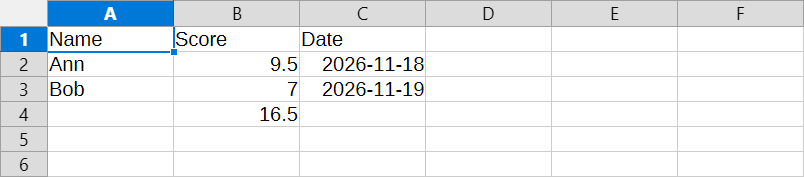
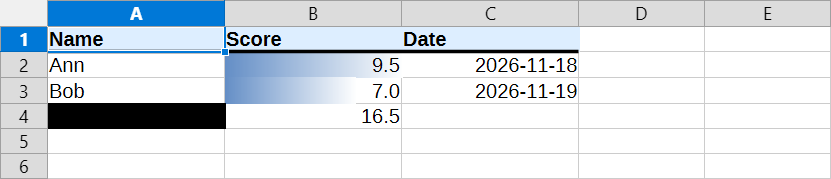
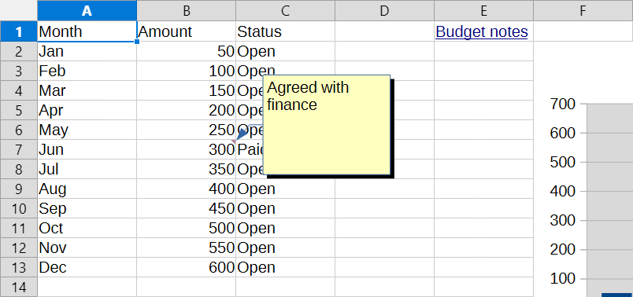
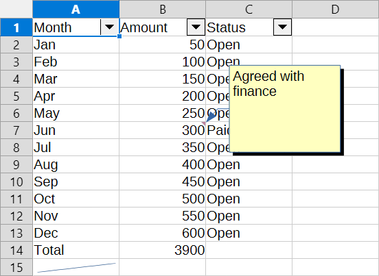
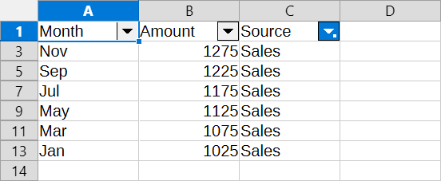
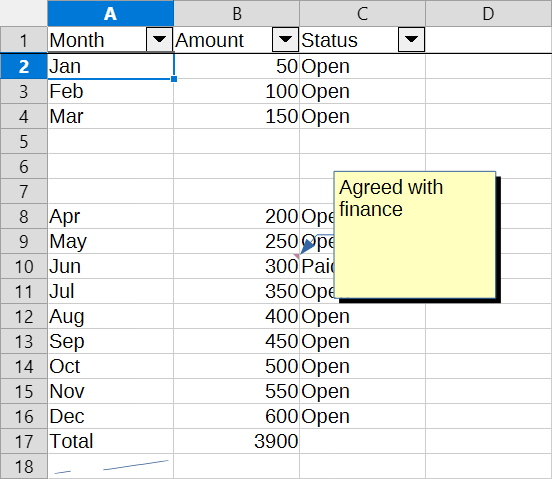

```@meta
CurrentModule = OpenDocumentSpreadsheets
```

# Tutorial

This tutorial makes a small budget file, reads it, writes and formats a new file, then edits the
budget. Run the examples in order, in one Julia session: each uses what the ones before it made. The
files are written to the current directory (`pwd()`). Each step links to the page that covers it in
full.

In these examples and throughout the guide, `xf` is an open file and `sh` is one of its sheets.

## A file to work with

The tutorial reads and edits `budget.ods`, a year of income and costs. This example makes it; the
steps below explain the functions it uses:

```julia
using OpenDocumentSpreadsheets

months = ["Jan", "Feb", "Mar", "Apr", "May", "Jun", "Jul", "Aug", "Sep", "Oct", "Nov", "Dec"]

xf = newods("Income")                     # a new file, with one sheet
income = xf["Income"]
income["A1:C1"] = ["Month" "Amount" "Source"]
for (i, m) in enumerate(months)
    income[i+1, 1] = m
    income[i+1, 2] = 1000.0 + 25i
    income[i+1, 3] = isodd(i) ? "Sales" : "Grants"
end

costs = addsheet!(xf, "Costs")
costs["A1:C1"] = ["Month" "Amount" "Status"]
for (i, m) in enumerate(months)
    costs[i+1, 1] = m
    costs[i+1, 2] = 50.0i
    costs[i+1, 3] = "Open"
end

writeods("budget.ods", xf; overwrite = true)
```

## Reading a file

[`readods`](@ref) opens a file and returns an [`ODSFile`](@ref). A sheet is read the first time it
is used.

```julia
xf = readods("budget.ods")
sheetnames(xf)            # ["Income", "Costs"]
sh = xf["Costs"]          # or xf[2]

sh["B3"]                  # 100.0; a cell gives a number, string, Date, ..., or missing
sh["A1:C3"]               # a 3×3 Matrix{Any}
sh[2, 3]                  # row 2, column 3: "Open"
sh[:, 1]                  # column A, as far as the sheet has data
sh[:]                     # everything
```

To read one value or range without keeping the file open, use [`readdata`](@ref):

```julia
readdata("budget.ods", "Costs", "B2:B4")
readdata("budget.ods", "Costs.B2:B4")       # the sheet named in the reference
```

[Addressing cells and ranges](../concepts/addressing.md) covers every form a reference can take, and
[Values and types](../concepts/values.md) what each kind of cell reads as.

## Reading a table

Here a *table* is any block of rows under a header row, which is how most sheets hold their data. It
doesn't have to be a database range (Data ▸ Define Range); those are covered in
[Database ranges](../data/tables.md).

[`readtable`](@ref) reads a table into a `DataTable`, which any Tables.jl sink accepts, such as a
DataFrame (this example needs DataFrames.jl installed):

```julia
using DataFrames
df = DataFrame(readtable("budget.ods", "Income"))    # 12 rows: Month, Amount, Source
```

Without further keywords, the table starts at the first row with data and spans the first run of
non-empty header cells. Columns, the first row, labels and the handling of empty rows can all be
chosen: see [`readtable`](@ref).

## Rows

[`eachrow`](@ref Base.eachrow(::Worksheet)) gives the rows that have content:

```julia
for r in eachrow(xf["Costs"])
    println(row_number(r), ": ", r[1], " ", r["B"])
end
```

## Writing a new file

```julia
using Dates

xf = newods("Results")
sh = xf["Results"]
sh["A1"] = "Name"
sh["B1"] = "Score"
sh["C1"] = "Date"
sh["A2:B3"] = ["Ann" 9.5; "Bob" 7]
sh["C2"] = Date(2026, 11, 18)
sh["C3"] = Date(2026, 11, 19)
setFormula(sh, "B4"; val = "=SUM(B2:B3)")
writeods("results.ods", xf; overwrite = true)
```

Opened in LibreOffice, the file shows the values, the dates in ISO form, and the formula's result,
which LibreOffice calculates when it loads the file:

```@raw html
<!-- shot: tutorial_write cells=6x6 -->
```


Or write a whole table at once, from any Tables.jl source, such as the DataFrame read above or a
named tuple of vectors:

```julia
writetable("income.ods", df; sheetname = "Income", overwrite = true)

people = (Name = ["Ann", "Bob"], Team = ["North", "South"])
writetable("all.ods", "Income" => df, "People" => people; overwrite = true)   # one sheet each
```

## Formatting

Cells take fonts, fills, borders, number formats and LibreOffice's named cell styles:

```julia
setFont(sh, "A1:C1"; bold = true)
setFill(sh, "A1:C1"; pattern = "solid", fgColor = "DDEEFF")   # a pale blue background
setBorder(sh, "A1:C1"; bottom = ["style" => "medium"])
setFormat(sh, "B2:B4"; format = "0.0")
setColumnWidth(sh, "A:C"; width = 14)
setCellStyle(sh, "A4", "Accent 1")
setConditionalFormat(sh, "B2:B3", :dataBar)
writeods("results.ods", xf; overwrite = true)                 # save the formatting
```

```@raw html
<!-- shot: tutorial_format cells=5x6 -->
```


[Cell formats](../formatting/cellFormatting.md) and
[Conditional formats](../formatting/conditionalFormatting.md) cover the rest.

## Editing a file

Open it with `mode="rw"`. The do-block form saves the file when the block ends:

```julia
openods("budget.ods"; mode = "rw") do xf
    xf["Costs"]["C7"] = "Paid"                    # June's costs are paid
    addsheet!(xf, "Summary")["A1"] = "Total"
end
```

Everything you don't change (styles, column widths, notes, pictures, charts, settings) is kept
exactly as it was: see [Creating and editing files](creatingFiles.md).

## Charts and sparklines

```julia
using OpenDocumentSpreadsheets.Charts

openods("budget.ods"; mode = "rw") do xf
    sh = xf["Costs"]
    c = addChart(sh, :column; anchor = "F2:M18", title = "Costs by month")
    addSeries(c, "B2:B13"; categories = "A2:A13", name_ref = "B1")
    setLegendPos(c, :b)                       # the legend at the bottom
    addSparklines(sh, "A15", "B2:B13")       # the year's amounts, in one cell
end
```

```@raw html
<!-- shot: tutorial_chart file=budget.ods sheet=Costs cells=13x19 -->
```


[Charts](../charts/overview.md) covers charts, histograms, chart sheets and sparklines.

## A link, a note and a drop-down list

A hyperlink, a note on a cell (LibreOffice's Insert ▸ Comment), and a Validity rule that limits the
Status column to two values, offered as a drop-down list:

```julia
openods("budget.ods"; mode = "rw") do xf
    sh = xf["Costs"]
    addHyperlink(sh, "E1"; url = "https://example.org/budget", display = "Budget notes")
    addComment(sh, "B7", "Agreed with finance"; author = "Ann", visible = true)
    addDataValidation(sh, "C2:C13"; type = :list, values = ["Open", "Paid"])
end
```

```@raw html
<!-- shot: tutorial_links file=budget.ods sheet=Costs cells=6x14 -->
```


The Status cells now offer Open and Paid, and refuse anything else.
[Hyperlinks](../objects/hyperlinks.md), [Notes and comments](../objects/notes.md) and
[Validity](../data/validity.md) cover each in full.

## A database range with a totals row

[`addtable!`](@ref) makes a block of rows under a header row a database range, as LibreOffice's
Data ▸ Define Range does: the header gets filter buttons. [`settotals!`](@ref) adds a totals row
below it:

```julia
openods("budget.ods"; mode = "rw") do xf
    t = addtable!(xf["Costs"], "A1:C13"; name = "Costs")
    settotals!(t, "Month" => "Total", "Amount" => :sum)    # the totals row is row 14
end
```

```@raw html
<!-- shot: tutorial_table file=budget.ods sheet=Costs cells=4x15 -->
```


The total is a formula (`SUBTOTAL(109,…)`), which LibreOffice calculates when it opens the file. See
[Database ranges](../data/tables.md).

## Filtering and sorting

[`setAutoFilter`](@ref) puts filter buttons on a range's header, as Data ▸ AutoFilter does, and can
also filter and sort it, so the file opens that way. Here, the income from sales, largest first:

```julia
openods("budget.ods"; mode = "rw") do xf
    setAutoFilter(xf["Income"], "A1:C13"; filters = ["Source" => ["Sales"]],
                  sort = "Amount" => :descending)
end
```

```@raw html
<!-- shot: tutorial_filter file=budget.ods sheet=Income cells=4x14 -->
```


[AutoFilter and sorting](../data/autoFilter.md) covers the criteria and the sort's options.

## Rows, columns and sheets

Rows, columns and sheets can be inserted, deleted, renamed, copied and moved, and the references to
them follow, as they do in LibreOffice. Here three empty rows go in before row 5 (April), the sheet is
renamed and copied, and its header row is frozen:

```julia
openods("budget.ods"; mode = "rw") do xf
    sh = xf["Costs"]
    insertRows(sh, 5; count = 3)           # the totals row moves to row 17, and sums B2:B16
    renamesheet!(sh, "Costs 2027")
    copysheet!(sh)                         # "Costs 2027 (copy)"
    freezePanes(sh; nrows = 1)             # row 1 stays in view while the rest scrolls
end
```

```@raw html
<!-- shot: tutorial_sheets file=budget.ods sheet=Costs_2027 cells=4x18 top=keep cursor=keep -->
```


The database range, the chart, the note and the totals formula moved with their rows. See
[Inserting and deleting rows and columns](../layout/insertDelete.md) and
[Managing sheets](../sheets/sheets.md).

## Page setup and document properties

How the sheet prints, and the file's title (File ▸ Properties):

```julia
openods("budget.ods"; mode = "rw") do xf
    setPageSetup(xf["Costs 2027"]; orientation = :landscape, fitToWidth = 1)
    setDocumentProperties(xf; title = "Budget 2027")
end
```

See [Page setup and printing](../sheets/printing.md) and
[Document properties](../sheets/properties.md).

## Large files

For files too large to hold in memory, write rows as they are produced, and read them one at a time
without loading the whole sheet (`enable_cache = false`):

```julia
streamods("squares.ods"; overwrite = true) do s
    sh = addsheet!(s, "data"; columns = ["n", "square"])
    for n in 1:1_000_000
        writerow!(sh, (n, n^2))
    end
end

openods("squares.ods"; enable_cache = false) do xf
    for r in eachrow(xf["data"])
        row_number(r) == 1 && continue      # the header
        # ... use r[1] and r[2]
    end
end
```

See [Saving and large files](../saving.md).
